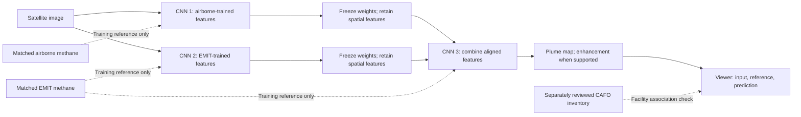

# GTM_Model6: implementation plan for the next machine

Date: October 2, 2026. October 21 update: the segmentation implementation is available. See the [training and viewer runbook](GTM_Model6_three_cnn_runbook.md). Local synthetic training checks the software. No measured methane result is established. The sections below retain the proposal and its research decisions.

## Decision

Start preparation now. Use two separate tasks:

1. Find and review likely animal facilities from aerial images.
2. Predict methane from satellite images, with measured methane as the training reference.

A reviewed facility can be marked as a **potential methane source**. It cannot supply a plume outline, an emission rate, or proof of a plume on a specific date. A model trained only to find CAFOs is a facility detector. It can be useful, but its accuracy must not be reported as methane accuracy.

Keep the available EMIT data. Use the original measurement products where their units and quality are documented. Add the intended airborne data when we identify it. CAFOs help with site selection and a separate facility-recovery check. They do not replace these measurements.

A real livestock facility can emit methane without a plume that Sentinel-2 can detect on a given date. The published Sentinel method targets large point sources, and sensitivity depends on conditions. Therefore, recovering every CAFO is not a valid methane-detection requirement. If the available satellite bands do not contain a recoverable signal for the intended sources, retain a facility-screening result or use methane-sensitive observations instead of forcing plume-shaped predictions. See the [Sentinel-2 methane study](https://amt.copernicus.org/articles/14/2771/2021/index.html).

## What the recording supports

The source is the October 2 meeting recording and its local machine transcript. The transcript can contain errors. The recording and transcript stay outside Git.

| Time | Meaning for this plan |
|---|---|
| 18:23 to 19:11 | Prefer the newer facility inventory. Check locations visually. Martin described repeated long roofs and noted that some older points appeared to identify farmhouses. |
| 19:12 to 19:42 | Martin briefly agreed with treating facilities as sources, then said their plume shapes were unknown. He identified the airborne observations as the better methane reference. |
| 20:35 to 22:42 | Train on measured methane. Predict candidate regions. Then check how many known CAFO locations the regions recover. Unmatched regions need review. |
| 32:53 to 38:19 | Train separate airborne and EMIT branches. Freeze them. Train the combining network with EMIT. |
| 48:00 to 49:18 | Joshua's final recap confirms the two trained branches followed by the third CNN. |

This is not a clear instruction to draw assumed methane plumes around every CAFO. The earlier [meeting note](GTM_Model0_meeting_actions_20261002.md) records the full discussion.

## Facility review: what we can do now

Use high-resolution aerial RGB for the first visual review. Sentinel-2 is useful for the research input, but individual pens, silos, and small roofs are harder to identify at its resolution. Its RGB bands are 10 m and its two SWIR bands are 20 m. See the [Sentinel-2 instrument description](https://sentiwiki.copernicus.eu/web/s2-mission).

The review can assign these appearance labels:

- Likely animal facility.
- Likely residence or other facility.
- Uncertain or insufficient image coverage.

Record the visible evidence, image date, source, footprint, site identity, reviewer, and confidence. Record a proposed animal type only when the image supports it. Keep the original inventory label and the review label in separate fields. Aerial appearance alone does not establish a legal CAFO designation or current operation. See the [EPA AFO definition](https://www.epa.gov/npdes/animal-feeding-operations-afos).

Look for several cues together: divided pens, visible animals, long sheds, feed silos, feed lanes, manure storage, and the surrounding farm layout. A repeated roof pattern alone is insufficient. Include greenhouses, warehouses, mobile-home parks, rural homes, and ordinary farmsteads as difficult comparison cases. Keep poultry, dairy, and beef facilities separate where possible. They are not interchangeable methane labels.

Before a reviewed label enters training, have Sean or another human reviewer check it. Review every uncertain case and a fixed random sample from each confident class. Reserve a separately reviewed evaluation sample. Do not evaluate an image model only against labels produced by the same image model.

### Small visual check completed in this pass

I inspected the existing 17-image CAFOSat contact sheet and opened samples 03, 08, and 11 at full size. These are provisional observations, not new training labels:

| Cached image | Visible evidence | Provisional judgment |
|---|---|---|
| [03](../outputs/GTM_Model0_hf_pilot_20260925/review/CAFOSat/cafosat_03.png) | Many cattle are visible inside divided dirt pens, beside feed lanes. | Strong visual evidence of a cattle feeding facility. Legal status and methane on the image date remain unverified. |
| [08](../outputs/GTM_Model0_hf_pilot_20260925/review/CAFOSat/cafosat_08.png) | Five long parallel sheds have repeated silos at their ends. | Likely animal housing, consistent with poultry-style sheds. The image does not establish cattle or a methane plume. |
| [11](../outputs/GTM_Model0_hf_pilot_20260925/review/CAFOSat/cafosat_11.png) | Houses, barns, a silo, fields, and a pond are visible. Part of another building complex is at the image edge. | Uncertain farmstead. The crop does not justify a confident large-facility label or a methane-negative label. |

These links use the existing local cache. They are not included in a fresh Git clone.

The [previous intake audit](../reports/research/GTM_Model0_hf_pilot_review_20260925.md) found archive-state/header-coordinate conflicts in eight of the 17 files and duplicate RGB images. Dates and verified facility IDs were missing. Resolve these issues before matching locations to Sentinel or EMIT. Do not discard useful images solely because their archive name is wrong; establish which metadata are correct first.

## Proposed model

Use Sentinel-2 as the provisional satellite input because it matches the existing project. The meeting said Landsat. This assumption can be changed before the manifest is frozen. Do not relabel one sensor as the other.

Only satellite imagery is required from outside the complete model during prediction. The frozen CNNs still run. CNN 3 cannot use their features if they are removed. A model that takes raw imagery directly into CNN 3 alone would require a separate distillation experiment.

Start with small spatial encoders and small map decoders. A candidate encoder has three blocks with 32, 64, and 128 channels, two 3-by-3 convolutions per block, and skip features. This is an implementation hypothesis, not a claim that these settings are optimal. Keep feature maps as grids. Do not flatten the whole scene to one classification score.

Train CNN 1 and CNN 2 independently, with separate temporary prediction heads. Freeze their weights and normalization state. Project their aligned features to equal channel counts. Concatenate them and train a small CNN 3 with the final prediction heads. Compare CNN 2 alone against the combined model on exactly the same independent sites.

Use the current five-band order: B2, B3, B4, B11, B12. Begin with a common 20 m input grid after a verified reflectance conversion. Keep the original native rasters. Process complete scenes with overlapping tiles and a context margin. Show unsupported borders explicitly. A plume must not be clipped merely to fit one small training window.

Keep a temporal target/reference baseline in the comparison. Static farm appearance must not become a substitute for evidence of gas. Published Sentinel methane retrievals use spectral and temporal information; [Varon et al.](https://amt.copernicus.org/articles/14/2771/2021/index.html) use L1C top-of-atmosphere SWIR reflectances. Do not assume an L2A surface-reflectance image is interchangeable. Reuse verified L1C pairs for the physical baseline where possible. The existing L2A offset conflict still needs an exact-product resolution.

### Target rules

| Target | Permitted use |
|---|---|
| Reviewed facility appearance | A separate facility classifier or candidate layer. No methane loss. |
| Verified methane plume mask | A supported-pixel segmentation loss. Unknown pixels remain ignored. |
| Quantitative EMIT enhancement with valid QA | A masked regression loss in the documented units, assessed on native EMIT support. |
| Airborne imaging-spectrometer retrieval | Supervision on its measured support after time, grid, units, and QA checks. |
| Aircraft point samples | Sparse supervision only after the observation meaning is defined. Never spread each point into an assumed plume. |
| Another model's methane prediction | A comparison or explicitly named pseudo-label. Not independent measurement truth. |

Airborne point concentration and EMIT column enhancement are different quantities. They must not share a loss as if they had the same units. If Martin's aircraft data are in-situ samples, define their time, altitude, background, and observation model first. A separate point head may learn useful features, but it does not establish a dense methane map.

Start segmentation only where a defensible mask exists. Add quantitative regression only where units and QA are established. Use an uncertainty-aware masked regression loss without silently clipping negative retrieval noise to zero. Keep the plume and enhancement outputs separate in the viewer.

EMIT supervision can constrain a finer prediction after aggregation to EMIT's native grid. It cannot, alone, establish that the fine pixels are correct. A 20 m output is an experimental reconstruction until independent finer methane measurements validate it.

## Five implementation passes

The cohort sizes and run limits below are proposed engineering targets. They are not statements from Martin or guarantees of sufficient statistical power.

| Pass | Work | Artifact and completion check |
|---|---|---|
| 1. Establish data and machine inputs | Verify machine access, GPU memory, software, disk quota, and cached files. Identify the aircraft data. Resolve facility coordinates and measurement semantics. Build distinct facility and methane manifests. | Environment receipt, source hashes, cost estimate, and input/reference contact sheets. Each accepted row has an explicit label type and support. No unresolved row enters training. |
| 2. Establish visible baselines | Review a small facility cohort. Compare a simple facility classifier against a pretrained aerial encoder. Separately reproduce a measured-methane baseline and the small CNN 2 model on the approved cohort. | Real predictions in the viewer, with untouched inputs and labels. Include missed plumes, false detections, and empty predictions. A training-fit check is labeled as such. |
| 3. Train the two methane branches | Train CNN 1 against the identified airborne target and CNN 2 against EMIT. Use the same geographic exclusions across both. Test a small pretrained encoder as an alternative initialization. | Separate checkpoints, data identities, loss definitions, and full-scene exports for each branch. If airborne data fail readiness, continue the explicitly named EMIT-only study. |
| 4. Train and test CNN 3 | Freeze the two encoders. Train the feature combiner. Compare with CNN 2 alone and a simple compatible-output baseline. | A paired comparison on common held-out sites. Retain CNN 3 only if it improves meaningful plume recovery without unacceptable additional false detections. |
| 5. Test regional screening and handoff | Scan a small predeclared US region containing known facilities and difficult comparison areas. Check candidates, missed facilities, seams, and review workload. Publish completed bundles to the existing viewer. | A reproducible regional map, reviewed sample list, full-run metrics, and a clean-machine viewer check. Expand coverage only after this pass succeeds. |

For the facility pilot, aim initially for about 50 reviewed facilities and 50 difficult non-facility examples across several regions. Keep uncertain examples in a separate review queue. This is a feasibility study, not national validation. The current 17 unverified patches are insufficient for this split.

For the methane pilot, aim to assemble at least 20 independent positive site/event groups and 20 reviewed observable control groups across multiple regions. Count groups, not rotated chips. If the data cannot support independent positive and control groups in evaluation, report an engineering diagnostic and stop the scientific comparison. A larger GPU does not remove this requirement.

## Split, augmentation, and comparison rules

1. Freeze geographic site groups before any task-specific training or label-driven selection. Join overlapping footprints and related source IDs. Preserve flight and acquisition identities.
2. Keep final evaluation sites outside both branches, the combiner, normalization fitting, and the facility-training task.
3. Reserve development validation for early stopping and threshold selection. Do not choose thresholds from the final evaluation maps.
4. For the smallest pilot, use disjoint branch-fit, fusion-fit, development-validation, and final-evaluation groups. This gives a simple audit trail. If data are insufficient, defer learned fusion. A later cross-fitted design needs its own lineage check.
5. Apply the same rotation or mirror to imagery, labels, valid support, and any spatial vectors. Transform wind vectors if used. Remove invalid rotated corners.
6. Treat the eight augmented views as one original observation. Use original scenes for the primary evaluation. Additional transformed evaluation is a robustness test.
7. Keep Martin's train-20-percent/check-80-percent rotations as a later data-efficiency test. Use geographic groups and preserve calibration data within the training side. This does not replace a final independent check.

For methane, report native-grid plume precision, recall, IoU, event recovery, and false detections per observed area. For valid enhancement, report error on plume support and supported background separately. Report intervals over independent groups when their number permits it.

For facility screening, report facility precision and recall on human-reviewed labels. A recovered known CAFO is supporting context for a methane candidate, not independent proof of a correct plume. Review a random sample of unmatched detections. Do not call each unmatched point a false positive, or assume it is an oil well.

Add same-site observations with and without independently observed plumes whenever available. Compare against RGB-only or facility-only controls. If the methane model highlights the same roofs on every date, or its gas-sensitive inputs add no held-site benefit, investigate surface recognition before making a methane claim.

## Code and viewer work to implement

Keep the new work under `research/GTM_Model6/` and use the `GTM_Model6_` filename prefix. Preserve old checkpoints and failed runs. Do not create empty modules that suggest a working trainer.

The necessary components are:

- A manifest reader that enforces sensor, band order, product level, units, timestamps, coordinates, site groups, support, reviewer status, and hashes.
- The two encoders, their task-specific training heads, and the frozen-feature combiner.
- A staged runner that records stage, fit groups, parent checkpoints, configuration, and actual runtime cost.
- An evaluator that reads saved native arrays, then exports the same values to the viewer.
- An exporter that uses the existing result-bundle and publication mechanism. Publish a result only when its assets and manifest are complete.

Use the existing viewer on the backend machine. Show the satellite image, methane reference, and prediction together. Identify every layer as measurement, model prediction, facility context, or unknown support. Add branch and combined-model choices only after their outputs exist. Show date, sensor, run, split, units, and full-run scores. Keep provisional facility marks visually distinct from confirmed methane observations.

Keep Sean's display copy lightweight. Copy completed viewer bundles and source hashes, not raw hyperspectral archives or a training environment. Use the existing private access route or an SSH tunnel for live review; a local saved bundle remains usable without a running GPU.

Before implementation, write the failure cases and E2E acceptance steps. Exercise the public workflow through manifest, short training, saved output, export, and browser display. Verify a reload reproduces the same prediction. Reject swapped bands, shifted grids, duplicate sites across splits, unknown-as-negative labels, mixed units, target leakage, stale checkpoints, and incomplete published bundles. Retain a JSON receipt and screenshots.

## Compute and stop rules

Use a small batch and one seed for the first development comparison. Cap each initial training attempt at 30 GPU minutes. Inspect its maps before extending it. Use repeated seeds only for candidates that pass the data and visual checks. Do not start a large architecture sweep or a national download.

Stop an affected experiment if:

- Its label type, source identity, grid, units, or evaluation split is wrong or unresolved.
- It produces constant boxes, blank outputs on all positives, or widespread roof/road activations.
- It cannot improve on a simple baseline on independent development data.
- Its transfer exceeds the approved file list or byte limit.

Keep progress on unaffected work, such as facility review or the viewer. The full three-CNN experiment is not required before an honest EMIT-only baseline can run.

Current shared imagery allowance: **3,768,186 bytes remain from 104,857,600 bytes**. Preserve the ledger. Quote exact selected files and transfer sizes before any larger acquisition. Track model-weight transfers separately; do not clone entire model repositories or their training data. No new imagery or model weights were downloaded during this planning pass.

## What is ready and what is still needed

The cached evidence replay passed and preserved the current budget. It still reports `training_ready=false`. Receipt: `output/GTM_Model6_plan_readiness_20261002.json`. This verifies existing file identities, not the missing scientific definitions. The legacy raster audit could not run in the current Python environment: `rasterio` is missing, and the old virtual environment points to an unavailable Python executable. No environment was installed or changed for this plan.

We still need machine access and the actual airborne dataset name or file location. We also need validated facility metadata, reviewed methane controls, resolved radiometry, and enough independent matched sites. The [October 1 data review](../reports/research/GTM_Model6_data_contract_brief_20261001.md) records the measurement issues in detail.

The [pretrained-model survey](../reports/research/GTM_Model0_pretrained_model_survey_20261002.md) gives the comparison choices. Start with a small CNN and a small satellite-pretrained CNN. Test DOFA or Prithvi next. Treat MAPL-EMIT and STARCOP as independent methane comparison systems with their required inputs. Their predictions do not become ground truth by being pretrained.

No new three-CNN result, nationwide detection result, or validated methane upscaling result exists yet.
