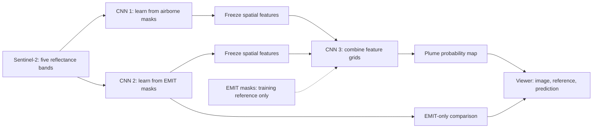

# Train and inspect the three-CNN model

Use branch `research/gtm-model6-restart-2026-09-22`. This workflow implements the October meeting proposal. It preserves earlier experiments. CAFO locations are not methane masks.

## Model



CNN 1 and CNN 2 each use a small U-Net with three spatial scales and a map decoder. CNN 3 combines their feature grids. Both branches stay frozen during this step. Each branch keeps its own normalization. All three networks run during combined prediction. Only Sentinel imagery enters from outside the complete model.

The first version predicts **plume probability**, not methane concentration, emission rate, or a confirmed source point. It predicts on a 20 m grid. It averages that prediction to the measurement grid for training and scoring. With a 60 m EMIT reference, this creates a finer experimental map. It does not prove that the fine detail is correct. Quantitative enhancement needs a separate target contract with verified units and quality flags.

Fitting uses eight distinct right-angle and mirror transforms. These add no downloaded data or independent sites. Validation and test use original scenes. Arbitrary 15 to 45 degree rotations are not included in this first implementation.

## Data needed

Real training still needs working VM access, the intended airborne dataset, and an approved paired-data manifest. The earlier cached-data audit remains blocked.

Each prepared scene needs:

- Sentinel bands B2, B3, B4, B11, B12, in that order.
- Verified reflectance conversion, product level, acquisition time, and valid input pixels.
- A measured airborne or EMIT mask. Unknown cells must stay unknown.
- A checked time match and exact input-to-reference grid alignment.
- Original source IDs, file hashes, site groups, and a named reviewer.
- Separate groups for branch fitting, combination fitting, validation, and final test.

Fitting and validation each need positive and reviewed negative cells. A positive outline alone does not establish methane-free background. Use one common projected metre CRS per prepared manifest. See the [data and failure contract](GTM_Model6_three_cnn_acceptance_20261021.md). Finer airborne grids need a reviewed preparation step; the loader does not silently resample them.

The [manifest example](../research/GTM_Model6/manifests/GTM_Model6_three_cnn_manifest.example.json) is deliberately incomplete and unapproved. Do not change review flags just to pass the loader.

## VM setup

Run after SSH works. Martin supplied the environment helper; its success on the VM is still unverified.

```bash
# First setup only, if Martin's environment does not exist:
tf-venv-setup

tmux new -s training
source ~/tf-env/bin/activate
cd /path/to/ersrr-ordinal-win
git switch research/gtm-model6-restart-2026-09-22
python tools/GTM_Model6_three_cnn.py doctor --require-gpu
```

Activate the environment inside tmux. Calling its Python executable directly can miss the CUDA library settings in the activation script. Do not start real training if the GPU check fails. The first Blackwell operation can need compile time.

This workflow uses TensorFlow, NumPy, h5py, and Pillow. Measured-map exports also use rasterio. It needs no PyTorch, Flask website, Earth Engine credentials, or downloaded model weights. Check the [dependency list](../research/GTM_Model6/GTM_Model6_three_cnn_requirements.txt) against the installed environment before installing anything. Do not replace Martin's working TensorFlow or CUDA setup as a routine step.

## First measured run

Keep the approved manifest and its NPZ files together. Relative array paths must stay valid. Keep private data outside Git.

```bash
python tools/GTM_Model6_three_cnn.py preflight \
  --manifest /data/reviewed/manifest.json \
  --output outputs/GTM_Model6/preflight_20261021.json

# Start with CNN 2. Choose a NEW run directory.
python tools/GTM_Model6_three_cnn.py pipeline \
  --manifest /data/reviewed/manifest.json \
  --run-dir outputs/GTM_Model6/GTM_Model6_three_cnn_pilot_01 \
  --stage emit --require-gpu --publish
```

The first configuration allows 30 minutes per stage. It uses one seed and a fixed 0.50 threshold. Training retains the best validation weights and checks for early stopping. Time limits and partial epochs are recorded. Existing checkpoints cannot be overwritten. There is no automatic resume.

Inspect the saved EMIT predictions before extending the experiment. Use the same manifest, configuration, and run directory for the next stages:

```bash
python tools/GTM_Model6_three_cnn.py pipeline \
  --manifest /data/reviewed/manifest.json \
  --run-dir outputs/GTM_Model6/GTM_Model6_three_cnn_pilot_01 \
  --stage airborne --require-gpu --publish

python tools/GTM_Model6_three_cnn.py pipeline \
  --manifest /data/reviewed/manifest.json \
  --run-dir outputs/GTM_Model6/GTM_Model6_three_cnn_pilot_01 \
  --stage fusion --require-gpu --publish

python tools/GTM_Model6_three_cnn.py replay \
  --manifest /data/reviewed/manifest.json \
  --run-dir outputs/GTM_Model6/GTM_Model6_three_cnn_pilot_01 --stage all
```

The combination stage refuses missing or changed branch checkpoints. Its fitting groups must be outside branch fitting. Replay rebuilds the saved model and checks its probabilities and masks. It does not retrain.

Stop and review full-box predictions, missed positive scenes, widespread background activation, or no useful improvement over CNN 2. Retain failed arrays. A quality flag is not scientific approval. An empty prediction can be correct for a negative scene.

## Predict new scenes without EMIT

Prepare a reviewed Sentinel-only scene manifest. Use schema `GTM_Model6_three_cnn_scenes_v1` from the [input-only contract](GTM_Model6_three_cnn_acceptance_20261021.md). Each NPZ contains only `image` and `input_valid`. Do not add methane targets. Keep the five bands, reflectance conversion, 20 m grid, file hashes, and review records.

```bash
python tools/GTM_Model6_three_cnn.py infer \
  --scenes /data/reviewed/new_scenes/manifest.json \
  --run-dir outputs/GTM_Model6/GTM_Model6_three_cnn_pilot_01 \
  --stage fusion \
  --output-dir outputs/GTM_Model6/new_scene_predictions_01 \
  --publish
```

Use a new output directory each time. Inference needs the saved weights and training receipts for all three networks. It does not need the original training images, EMIT labels, or airborne labels. The viewer shows these predictions as **unscored** and leaves the reference unavailable. It cannot calculate accuracy without a reference.

## Inspect actual predictions

On the machine with the result bundles:

```bash
python tools/GTM_Model0_local_viewer.py --port 8766 --name "Research VM"
```

Open `http://127.0.0.1:8766/`. Choose **Full research archive**, then the new CNN 2, CNN 1, or CNN 3 run. Open **Compare results**. Select **Model score heatmap** for the complete score map, or **Thresholded mask**. Cyan marks the reference; orange marks prediction. Keep the original image beside both.

The comparison buttons select CNN 1, CNN 2, or CNN 3 when that network has a saved prediction for the same scene in the same run. They cannot substitute an unrelated scene. CNN 2 and CNN 3 share the held-out EMIT scenes for direct comparison.

Each export prints an exact link. Complete bundles appear while the viewer is open. Browser requests never start inference. Publication happens only after all assets are ready. A partial export cannot replace a complete result.

Native scores use the measurement grid. Display scores describe only the current display. The exporter checks the displayed values against the saved model arrays and recalculates native counts before publication. Fine detail remains experimental.

For remote access, keep the viewer on loopback. Run this on your own computer in a second terminal:

```bash
ssh -N -L 8766:127.0.0.1:8766 \
  -l krasnogo27@campus.up.edu machinelearning01.campus.up.edu
```

For Sean's offline viewer, copy the complete published run folder from `outputs/GTM_viewer_bundles/` to the same path on his machine. He needs the repository and Python, not training weights, raw imagery, or a GPU. See [Sean's setup](../GTM_Viewer/SEAN_SETUP.md). Keep status and reference notes with the bundle.

## Repeat the engineering check

Use a Python environment with the dependencies above. Choose a new output path:

```bash
python tools/GTM_Model6_three_cnn_e2e.py \
  --output outputs/GTM_Model6/GTM_Model6_three_cnn_e2e_repeat --epochs 6
```

This generates artificial curved plumes and negative scenes. It checks the public workflow, bad input rejection, separate groups, frozen branches, checkpoint replay, exact viewer values, and atomic publication. It also checks inference with every original training array and the training manifest unavailable. It retains a JSON receipt and logs. Browser screenshots complete visual verification. Synthetic data never become measured methane results or the default presentation.

Implementation references: [TensorFlow freezing guide](https://www.tensorflow.org/guide/keras/transfer_learning) and [Keras weight saving](https://keras.io/api/models/model_saving_apis/weights_saving_and_loading/).

## October 23 local review with many no-plume examples

This earlier local review uses **artificial data only**. It does not train on measured EMIT or airborne methane. The later real CNN 2 fitting run below uses the available Volusia pair. A broader evaluation still needs verified positive and no-plume pairs, consistent reflectance metadata, valid measurement support and independent sites. Missing labels cannot be used as confirmed no-plume labels.

Open [the HTML review](../outputs/GTM_viewer_bundles/GTM_Model6_learning_review_20261023/index.html). With the local viewer running, open `http://127.0.0.1:8766/bundle-assets/GTM_Model6_learning_review_20261023/index.html`. The HTML contains its images and numerical audit. You can copy that one file to another computer and open it. The experiment-viewer link also needs the viewer and its saved bundles.

Select CNN 1, CNN 2 or CNN 3 in the HTML. Inspect a plume and a no-plume example. Select **Forward pass**, then use the seven step buttons to inspect actual saved-model feature maps. The **Evidence** section gives all 240 model evaluations, settings and repeat commands.

This check contains 240 original artificial scenes, including 192 no-plume scenes. Each CNN has 16 positive and 64 negative test scenes. CNN 2 and CNN 3 share the same test set, so there are 160 unique test scenes. Eight rotation and mirror variants apply to fitting only. Each stage completed six epochs. The native CPU backend is `tools/GTM_Model6_three_cnn_torch.py`; its fixed small configuration is for this check only. Use the installed `hyworld2` environment on this PC. It uses float64 computation, one CPU thread, deterministic algorithms and no MKLDNN. The installed NumPy bridge is incompatible, so tensor transfers use Python lists. No installation is needed.

The accepted run is `outputs/GTM_Model6/GTM_Model6_learning_review_20261023/GTM_Model6_negative_rich_stable_20261023`. Its two audits are `audit_stable` and `audit_stable_replay`. `verification.json` records independent count checks and unchanged hashes for all 252 run files. Both audits reproduced the saved probabilities exactly. Frozen branch weights stayed unchanged during fusion fitting. The source snapshot is retained beside the run.

At the fixed 0.50 cutoff, CNN 1 has zero plume recall and fails this detection check. CNN 2 has 85.15% pooled native IoU; CNN 3 has 85.40%. Both find 89.04% of plume cells, with no false activation in the 64 artificial no-plume scenes. The small fusion gain is not evidence of a useful airborne contribution. These results do not establish real methane accuracy, source localization or useful upscaling.

Earlier native attempts failed numerical replay. The first attempt also lost original prediction bytes during an in-place repair. They are rejected, are not published to the viewer, and remain recorded in `GTM_Model6_negative_rich_20261023/INCIDENT.json`. The accepted run was fitted afresh after the numerical policy was fixed. Never refresh an old receipt to hide a failed check.

The existing TensorFlow workflow above remains the path for the later measured-data VM run. The native backend rejects measured manifests. It is not a replacement for preparing the real cohort.

## October 23 real CNN 2 fitting run

Real training has started locally. The separate entry point `tools/GTM_Model6_train_real_emit.py` accepts the prepared real annotation manifest. The artificial-only entry point above remains unchanged. Missing airborne data do not block CNN 2, and this small diagnostic does not require the VM or a GPU.

Open [the real-data HTML review](../outputs/GTM_Model6/GTM_Model6_real_emit_20261023/review_v2/index.html). It contains actual Sentinel inputs, the provider annotation, before/after output, errors, a learning curve and the input-to-loss diagram. With the viewer running, use:

`http://127.0.0.1:8766/?catalog=all&experiment=GTM_Model6_real_emit_20261023_cnn2_fit&scene=Volusia-20250601-fit#compare`

Select **Side by side**, then **Fit scene** to align all panes. Use **Disagreement** to inspect extra detections and misses. CNN 1 and CNN 3 have no real predictions in this run.

The input is one real Volusia pair, 12.742 minutes apart. It uses B2/B3/B4/B11/B12 on an aligned 20 m grid. The provider annotation remains at 60 m. A mean of each 3 x 3 prediction block enters the loss. Cloudy or unsupported cells are unknown. Background means unannotated within measured support, not confirmed methane absence. These restrictions are saved with the manifest and viewer bundle.

The run completed 160 epochs with equal annotated and all-background crop sampling and all eight rotation/mirror variants. At the fixed 0.50 cutoff, annotation IoU increased from 44.95% to 63.39%. This is agreement on the fitting scene, not held-out accuracy. It has 579 extra cells against weak background and 163 missed annotation cells. Fine output is not validated upscaling. Fresh checkpoint replay reproduced every saved probability exactly.

To repeat on this Windows PC, use the existing environments below. Choose new preparation, run and review paths. The commands do not download data or install packages.

```powershell
# From the repository root. Existing raster libraries live in this folder.
$env:PYTHONPATH = Join-Path (Get-Location) '.venv/Lib/site-packages'
& 'C:/Users/joshu/.pyenv/pyenv-win/versions/3.11.9/python.exe' tools/GTM_Model6_prepare_real_emit.py --output outputs/GTM_Model6/real_emit_repeat/data

# The native PyTorch environment uses its own NumPy.
Remove-Item Env:PYTHONPATH
& 'C:/Users/joshu/miniconda3/envs/hyworld2/python.exe' tools/GTM_Model6_train_real_emit.py fit --manifest outputs/GTM_Model6/real_emit_repeat/data/manifest.json --run-dir outputs/GTM_Model6/real_emit_repeat/cnn2 --epochs 160 --max-minutes 5 --tiles-per-epoch 24
& 'C:/Users/joshu/miniconda3/envs/hyworld2/python.exe' tools/GTM_Model6_train_real_emit.py replay --manifest outputs/GTM_Model6/real_emit_repeat/data/manifest.json --run-dir outputs/GTM_Model6/real_emit_repeat/cnn2

$env:PYTHONPATH = Join-Path (Get-Location) '.venv/Lib/site-packages'
& 'C:/Users/joshu/.pyenv/pyenv-win/versions/3.11.9/python.exe' tools/GTM_Model6_review_real_emit.py --manifest outputs/GTM_Model6/real_emit_repeat/data/manifest.json --run-dir outputs/GTM_Model6/real_emit_repeat/cnn2 --output outputs/GTM_Model6/real_emit_repeat/review --publish
Remove-Item Env:PYTHONPATH
```

Keep each accepted run immutable. `replay` checks the saved initial and final weights, source hashes, input data and prediction arrays. The renderer separately checks native counts, source pins, support and publication. Both refuse failed evidence.

Next, acquire the missing native EMIT targets for the nine cached US pairs in `outputs/GTM_Model6/GTM_Model6_real_emit_20261023/real_cache_inventory.json`. Their existing masks are catalog outlines and cannot substitute for plume labels. A continuous target needs a signed-retrieval regression objective with its actual units and valid support. Do not threshold all positive retrieval values into a mask. Retain existing Sentinel imagery, establish independent site groups and documented background controls, then fit CNN 2 on multiple scenes. CNN 1 and the full combination still need the separate airborne cohort.
