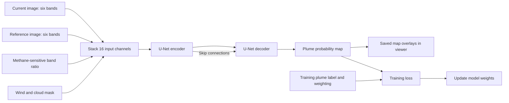

# MARS baseline: local training plan

The next step is a MARS-S2L baseline trained from new random weights. It gives us a stronger reference before we change the architecture again. This run uses the released U-Net design, its data preparation, its plume simulation and its training loss. It is a local adaptation, not an exact reproduction of the paper.

## What the model sees

The model has 13,587,585 parameters. It receives six satellite bands from the current image and six bands from the reference image. A methane-sensitive band ratio, two wind values and the current cloud mask bring the total to 16 channels. It predicts one plume score at each output pixel.

The training data contain real Sentinel-2 and Landsat observations. We also retain the release's augmentation, which inserts measured plume patterns into real backgrounds through its physical model. The validation and evaluation scenes are real observations. We do not test on artificial scenes.

The output is a plume mask on a 10 m grid. Sentinel SWIR measurements have 20 m spatial information. This baseline does not establish 10 m methane detail or estimate an emission rate.

## Data and separation

| Role | Observations | With a plume | Without a labeled plume |
| --- | ---: | ---: | ---: |
| Full public training inventory | 38,345 | 3,512 | 34,833 |
| Local training split | 30,304 | 2,246 | 28,058 |
| Validation for checkpoint selection | 1,102 | 117 | 985 |
| Model-unseen evaluation | 60 | 20 | 40 |

The local training split includes 25,051 Sentinel observations and 5,253 Landsat observations. We reserve complete groups of nearby sites for validation and evaluation. No site, 25 km site group or known acquisition ID is shared across these roles. The closest training and evaluation centers are about 50 km apart.

The evaluation contains 36 sites in ten geographic groups and seven countries. Only two plume observations and four clear observations are in the US. This is insufficient to claim national accuracy. These regions also appeared in earlier project assessments. The new model has not trained on the reserved locations, but this is an exploratory public-data evaluation, not a pristine external test.

The frozen plan is `tool-diagnostics/mars-baseline-20261030/plan.json`, SHA-256 `3b29c62bb250dd9155b1c2af90637b605f2709f7ec6c64b18662a0c9ed2a6345`. Country and methane-raster amendments preserve the original scene IDs. The training manifest is SHA-256 `59e9843ac329e6da81c5dbbebeb22cde5eaf170ee4a8a5a9c002e3afbfdc68d9`.

## Storage and acquisition

The active data and results paths point to `D:\Research\REMOTE-SENSING\ersrr-ordinal-win`. New caches and temporary files use this drive too. The source checkout and the existing Python environment remain on C:. The original data and results are retained for migration recovery.

The full public training inventory was already cached. We verified the objects against the pinned Hugging Face release rather than download duplicates. The combined checks cover 86,312 objects and 40,542,206,165 bytes, including the methane rasters needed for plume simulation. There were no hash failures and no new imagery transfers. The older CAFO download ledger is unchanged.

Use `tools/GTM_research_on_D.py` to launch training, review or the viewer with the D: paths. The model run is under `outputs/GTM_Model8_mars_baseline_20261030` on D:.

## Checks before training

- Confirm the released architecture and local implementation give the same output from the same weights.
- Check the source loss against a separate calculation.
- Use a real training plume and a real clear scene to check labels and inputs.
- Confirm that changing the plume label does not change the model input.
- Confirm that the model can learn a real training example and that saving its checkpoint preserves its output.
- Measure GPU memory, data preparation time and training speed on a fixed workload.

The upstream crop sampler has a tuple/scalar API mismatch. A documented adapter passes the scalar size for square crops. The upstream source files remain pinned. Python 3.11 uses a compatible physics package release whose relevant source and LUT bytes match the official lock. Smaller native batches and mixed precision are hardware adaptations and must be recorded with the run.

The release uses cloud information in its retrieval and as an input, but its training loss does not mask invalid pixels. We retain that convention for this baseline and state it in the receipts. In the viewer, native scores use observable pixels, before map reprojection.

## Training and review

The planned upper limit is 170 epochs, with 65,536 sampled examples per epoch. Use Adam at the pinned source's default learning rate of 0.0005. Select the best checkpoint by validation average precision, with the source's scene-score calculation and early-stop patience of 30 epochs. The public snapshot differs from the data counts in the released checkpoint, and the site separation changes its split. Do not describe this run as an exact published reproduction.

The holdout never controls the training schedule, threshold or checkpoint selection. Publish two predeclared snapshots: the first completed training epoch and the final validation-selected checkpoint. The first snapshot is marked interim. Each uses the same 60 evaluation scenes, including clear scenes and missed plumes. The fixed pixel cutoff is 0.50. Do not add dilation, fill extra area, remove difficult scenes or choose a better-looking threshold from these results.

Report pixel F1, precision, recall, overlap and false marks on clear scenes. Inspect the actual overlays as well as the numbers. The released pretrained model can appear beside the new baseline, with its training-location overlap stated. Its performance does not establish a fair architecture ranking.

The controller runs `tools/GTM_Model8_mars_run.py`. It keeps training logs, saves immutable review checkpoints and publishes saved predictions through the existing local viewer. A review failure is recorded and does not terminate the training process. Final publication requires a successful training exit and a fixed final checkpoint.

The verified local configuration is native batch 32, BF16 for CNN forward computation, FP32 for loss and Adam, and two Windows loader workers. A fixed-workload audit confirmed identical examples with zero or two workers. Source-model output parity and independent input reconstruction passed. The actual full fit began on October 30, 2026 at about 09:24 Pacific. It is still running when this note was written. The first trained snapshot will be under the full research archive as `GTM_Model8_mars_20261030_holdout_baseline`.

To open it after publication, use the local viewer at `http://127.0.0.1:8766/?catalog=all&experiment=GTM_Model8_mars_20261030_holdout_baseline#compare`, or the existing private Tailscale host with the same query. Switch the experiment to `GTM_Model8_mars_20261030_holdout_released_reference` to inspect the released checkpoint on the same scenes. Validation snapshots are labeled separately.

## First visible checkpoint

The first epoch finished after 65,536 training draws: 35,483 negative examples, 14,882 real plume examples and 15,171 physical plume insertions. This is an interim checkpoint. Full training is still running.

| Model on all 60 reserved scenes | Pixel F1 | Precision | Recall | Clear scenes with any marked pixel |
| --- | ---: | ---: | ---: | ---: |
| New baseline, first epoch | 22.1% | 64.1% | 13.3% | 10 of 40 |
| Released MARS reference | 65.7% | 61.8% | 70.2% | 6 of 40 |

The released model has exact training-location overlap for 19 observations in this set. This comparison is context, not a fair architecture ranking. The baseline is still missing most plume area. It is not ready for national use.

All 60 predictions were inspected in full contact sheets. They show partial plume detection, many missed plumes, and some false marks on dark water or terrain. The predictions are not filled image boxes. We did not alter labels, choose a different threshold, expand masks or change the training plan after this review.

A separate audit reproduced the pooled scores, checked all 1,012 served assets across the four bundles, and replayed both US plume observations and all four US clear observations from the first saved checkpoint. Their probability arrays matched exactly. The reports now show a gallery of every saved scene, alongside the interactive viewer. The final report will use the checkpoint selected by validation, after training ends.
