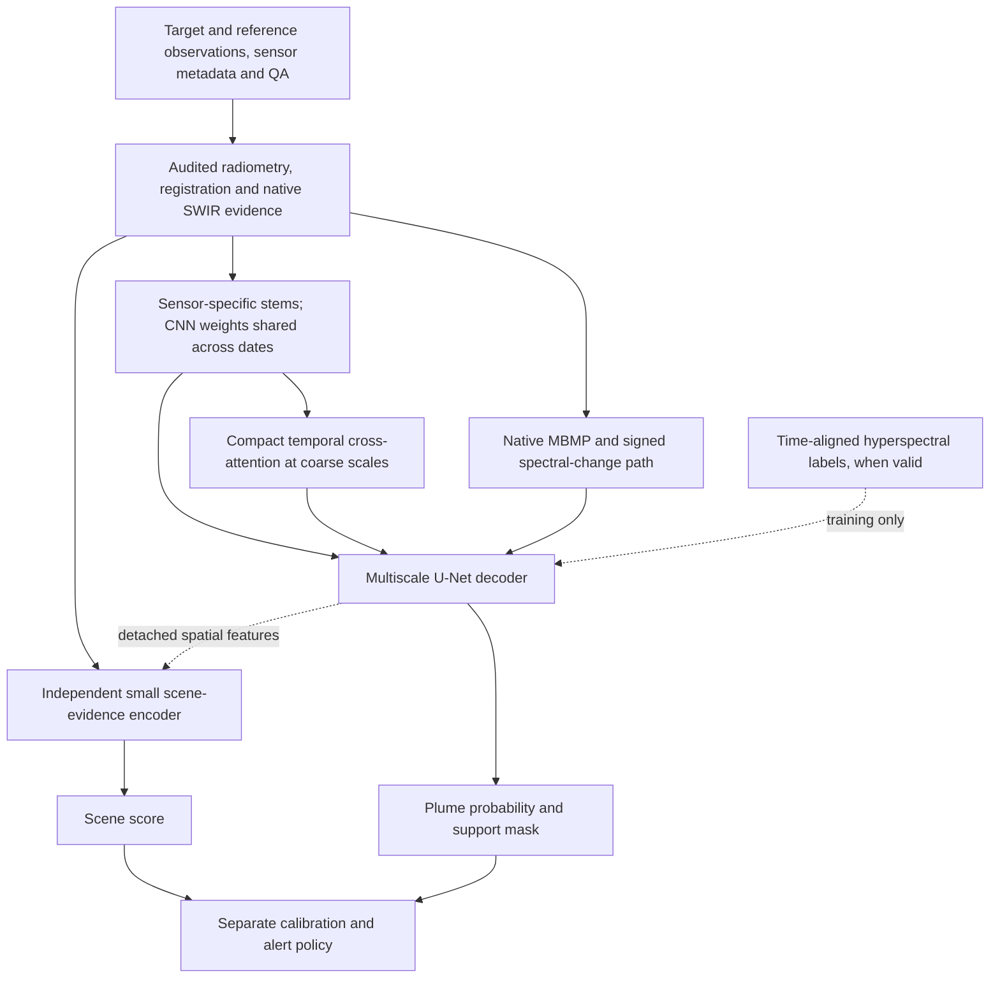

> **HISTORICAL PROPOSAL / REPORT.** Active work has restarted at [GTM_Model6](../../research/GTM_Model6/README.md). Claims and recommendations below belong to earlier research; they are not current results or execution instructions.

# ERSRR architecture recommendation

Review date: 2026-09-04. This is an independent design recommendation, not a trained result or an amendment to any frozen experiment.

My recommendation is a **sensor-aware temporal CNN–transformer hybrid with native-resolution methane evidence, a U-Net segmentation decoder, and a separately trained scene detector**. Keep the existing ensemble as the reference until this replacement proves itself on new geographic groups. I would not make learned SWIR sharpening, spectral reconstruction, a large generic foundation model, or ordinal enhancement prediction the central dependency.

There are two different answers to “best”: the strongest demonstrated system in this repository is the spatial-Prithvi/residual ensemble family with its conservative Gaussian+DOFA successor; the design below is my best next research hypothesis. The repository does not establish that any proposed architecture will outperform that ensemble.

## What problem the architecture should solve

The current scientific endpoints are detection of a methane plume in an observable scene and localization of its footprint in Sentinel-2/Landsat imagery. These are different from reconstructing an EMIT image, estimating physical methane enhancement, quantifying emission flux, or attributing a plume to a facility.

The original single-date S2-to-EMIT formulation bundles an inverse problem with cross-sensor resolution, timing, and supervision mismatches. A sharper predicted image cannot establish that methane was observed at that finer resolution. Likewise, an emission seen by EMIT at another time does not establish the same instantaneous plume in Sentinel-2. The primary architecture should predict what the target sensor supports; genuinely time-aligned hyperspectral observations can provide additional training supervision.

The local skill and some root-level proposals describe an approximately 100-tile project. That is historical. The later MARS paper protocol records 44,363 development scenes, 3,811 plume scenes, and 618 physical sites. The recent folds-3/4 experiments use 17,745 scenes but only 250 canonical geographic groups. Scene count therefore substantially overstates independent training evidence. These figures come from existing manifests and reports, not a new raster inventory.

## What the experiments actually establish

The rows below are different cohorts and tasks; their absolute AP and IoU values must not be ranked across rows.

| Experiment and population | Recorded result | Architectural implication |
|---|---|---|
| Legacy compact residual U-Net, 65 scenes / 32 groups, enhancement >300 ppm·m | Raw sampled pixel AUPRC 0.4168; engineered-physics version 0.4079 | Adding channels is not inherently useful; weak legacy supervision is a bottleneck. |
| Tri-temporal v5.1, sealed MethaneS2CM location test | Scene AP 0.8180; recall 0.3778; FPR 0.0607; IoU 0.1852 | Temporal CNNs learn useful representations, but geographic threshold and boundary transfer remain difficult. |
| Spatial-Prithvi ensemble, full official MARS post-test replay | AP 0.676102 versus 0.641020; IoU 0.379964 versus 0.324365 | Complementary pretrained context plus methane-specific spatial evidence is the strongest broad recorded result. |
| Same ensemble, official test-only sites | AP 0.467027 versus 0.450274, paired AP interval crosses zero; IoU 0.292462 versus 0.171562 | Dense improvement is supported; unseen-site scene-ranking superiority remains inconclusive. |
| Gaussian+DOFA, development folds 3/4 | AP 0.906525; gain +0.002449, paired interval [+0.000489,+0.004068]; matched-FPR recall unchanged | A useful but small complementary improvement, not a solved generalization problem. |
| Gaussian+DOFA, 4,401-row strict-spatial post-test diagnostic | AP 0.374894 versus 0.352123; recall 0.611940 versus 0.641791; FPR 0.056991 versus 0.095062 | Fewer false alarms accompanied lower recall; the superiority gate failed. This report makes no dense-improvement claim. |
| Product-aware v6 scene pilot | AP gain +0.000182, paired interval crosses zero | Product tokens and a new pretrained residual branch did not resolve the ranking ceiling. |
| Prithvi-100M CLS probe | AP delta -0.000288 | Nominal backbone scale and pooled generic features are insufficient evidence for an upgrade. |
| Selective proposal transformer | Best AP delta -0.00002365, recall unchanged; raised 42 negatives and zero positives | That selective rescue mechanism failed. This does not prove all transformers are unsuitable. |
| Sensor-aware ordinal U-Net, latest native Windows result | AP delta -0.786371; dense IoU delta -0.636630; all seven gates failed | Retire this configuration. It is not a successful or pending successor. |
| Stanford controlled-release stress test, one site | Gaussian+DOFA and spatial-Prithvi recall both 0 at their frozen rules; released MARS recall 0.125 | Benchmark gains have not established reliable sensitivity under this temporal stress test. There are no pixel masks for IoU. |

The separate 55-scene EMIT positive-only stress test also reports very low recall (ERSRR five-seed mean 0.011; released MARS 0.018), but up to six hours of acquisition offset prevents treating it as exact simultaneous target-sensor truth. It cannot estimate AP or FPR. These stress tests strengthen the case for new, well-aligned real observations; they do not justify tuning an alert threshold on their labels.

The ordinal result files are currently untracked in `ersrr-ordinal-win`, and its narrative log still describes the experiment as running. I used the completed JSON/Markdown outcome, while retaining that provenance caveat. The result is a test of a bundled replacement: from-scratch compact features, new supervision, sampling, and a detached scene descriptor. It does not isolate the causal effect of ordinal supervision. A training/evaluation contract audit would be more informative than inferring that ordinal learning itself is impossible.

The April root proposal's expected PSNR, IoU, and detection-limit gains are hypotheses, not experiment results. Restoration-benchmark improvements cannot be translated into methane detection gains. I would not use them to choose HAT or to promise a 200–500 kg/h detection threshold.

## Recommended architecture

### 1. Preserve the actual observations

Use target and at least one reference with six corresponding visible/NIR/SWIR bands. For Sentinel-2 these are B02/B03/B04/B08/B11/B12; Landsat uses its corresponding native bands. Preserve sensor, product level, ground sampling distance, time difference, registration quality, and per-frame cloud/validity information. Keep those meanings explicit rather than relabeling Landsat channels as Sentinel-2 wavelengths.

Compute methane-sensitive differences and MBMP from the native SWIR observations before optional sharpening. Use the verified product-specific radiometric adapter: the existing MARS loader's DN/5000 representation needs its documented conversion, but that convention must not be applied indiscriminately to new products. Normalize from fitting data only, and retain absolute reflectance information instead of independently standardizing away each scene's spectral change.

The main physical stream should retain native 20 m Sentinel-2 SWIR and 30 m Landsat support. Higher-resolution guide bands can have their own shallow convolutional stream. Predictions may be rendered on a finer grid, but grid spacing must not be represented as new measurement resolution. Exact MARS comparisons retain the frozen comparator/evaluator's grid and component rule.

Use only inference-available QA as model input. Label-availability or annotation-derived observable masks belong in loss/evaluation support, never in input features. Distinguish an unobservable scene from a confident negative.

### 2. Use convolutions for detail and attention for temporal context

My proposed initial specification is a residual U-Net with stage widths **32, 64, 128, 256**, with two convolutional blocks per stage and full-resolution skip connections. Use separate small sensor/product stems, and share each sensor's encoder weights across target and reference dates.

Add **two compact attention blocks at each of the two coarsest feature scales**, with widths 128/256 and four/eight heads. First compare target and reference tokens locally using temporal cross-attention; then exchange spatial context within shifted windows. Keep a residual route through the CNN so weak or missing temporal evidence need not erase spatial features. These are proposed starting dimensions, not a measured optimum or parameter-count claim.

Feed signed and absolute differences, native MBMP, and support masks into the multiscale decoder through small learned projections. Wind can condition coarse features when available, with an explicit missingness indicator. It should be a noisy auxiliary cue rather than a hard plume-shape constraint.

Start with the exact available reference pair. Additional references are a later ablation, selected by cloud, registration, temporal distance, and surface compatibility. Do not assume references are plume-free. Use masked attention for absent frames rather than presenting a copied target as an independent observation. For prospective alerts, reference selection must not depend on future acquisitions.

This design gives attention a specific role—comparing corresponding temporal evidence—without requiring a global ViT to learn spectral differences, tiny boundaries, and scene detection from scratch. It is still a hypothesis: the repository's failed reference-bank and v6 experiments mean that adding references or attention alone is not a compelling new contribution.

### 3. Separate localization from scene detection without starving the scene model

The dense head produces plume probabilities through the U-Net decoder. Train it with observable-pixel BCE and positive-scene Dice, explicitly retaining negative scenes in BCE. Normalize contributions per scene/group so large masks or large images do not dominate. Audit full-frame inference as well as crops before long runs.

The scene head should have **its own small trainable spatial encoder over physical/temporal evidence**, plus detached dense features. Pool evidence at several physical footprint scales and feed those pooled features to a compact classifier. It must see all eligible scenes, including hard negatives, rather than only proposals from another model.

Train the dense representation first, then freeze it while fitting the scene path. Scene gradients should not degrade the segmentation network. However, gradient isolation does not mean restricting scene learning to ten mask/ordinal summary scalars: if the dense representation misses a plume, a scalar-only scene head has little way to recover it. The independent raw-evidence route is essential to this proposal.

Keep full-scene context available, but test whether predictions survive background changes and transfer to unseen groups. Do not supply site IDs, coordinates, facility identity, or historical label prevalence as shortcuts. Avoid a permanent max-score rescue rule that can raise false positives but cannot correct them downward.

### 4. Make quantitative and hyperspectral supervision conditional

Initially predict binary plume probability. Do not repeat the failed ordinal replacement or add a concentration head merely because enhancement files exist.

If units, timestamps, uncertainty, and georegistration are verified, add a low-weight robust enhancement objective. Compare the predicted field after the label sensor's spatial response/downsampling with its measured target; do not supervise every fine pixel against a bilinearly enlarged coarse target. Treat non-simultaneous events as weak event-level evidence rather than exact instantaneous pixel truth.

Hyperspectral imagery is a training-only teacher if it will not exist at deployment. Prefer trustworthy mask/enhancement targets over an unvalidated large hidden-feature distillation objective. Broad-band observations do not uniquely determine a 285-band spectrum; a reconstructed spectrum is a model estimate, not an additional independent measurement.

## Assessment of the future transformer / super-resolution proposals

There are several proposals in the history. HAT is an old untested restoration proposal; the small selective proposal-verifier transformer has already failed; v6's product-aware transformer scene branch also failed. The newest documented unrun branch I found is the September 3 learned SWIR proposal.

The related tasks “Updates + questions” and “Research architecture and acquire” independently confirmed that there is no newer recorded transformer design. The SWIR proposal is a preprocessing experiment, not itself a new methane transformer architecture. Both tasks also confirmed the split between the canonical main checkout and the newest ordinal outcome in the native Windows checkout.

I agree with that proposal's conservative native-plus-auxiliary design, but assign it lower priority than new independent supervision and a valid scene detector. [SEN2SR's primary paper](https://doi.org/10.1016/j.rse.2025.115222) explicitly reports no significant methane-detectability improvement over original SWIR bands. Its imagery can look sharper without improving the actual detection task. Vegetation-guided spectral translation and 20 m-to-10 m spatial sharpening also solve different problems.

If tested, keep SEN2SRLite frozen, retain native SWIR/MBMP, and feed only an optional auxiliary branch with sharpened residuals, closure error, and stability diagnostics. Preserve separate scene/dense gates. Passing a coarse-resolution reconstruction test is necessary evidence about consistency, but insufficient evidence that inferred fine methane structure is real. Methane injections, RGB-edge shams, shifted guide bands, unchanged temporal pairs, and actual downstream false alarms are decisive controls.

The [2024 methane ViT paper](https://www.nature.com/articles/s41467-024-47754-y) supports temporal inputs and physically simulated training as a plausible approach. Its airborne comparison is explicitly indirect because of acquisition timing. It does not establish a transferable detection limit for this project. The [MARS-S2L paper](https://arxiv.org/html/2511.21777v3) independently supports current/reference reflectance, MBMP, wind/cloud information, and methane-specific simulation with a U-Net. Neither source establishes that a larger transformer is the missing ingredient here.

## Training and evidence needed before replacement

1. **Freeze the current references.** Preserve released MARS-S2L, the spatial-Prithvi system, and Gaussian+DOFA with their existing preprocessing and operating rules. Keep their different test histories visible.
2. **Obtain genuinely new geographic evidence.** The MethaneUnion audit identifies 52 positive and 56 negative novel training coordinates, pending raster/mask verification. These are not yet 108 verified independent usable groups. Near-event negative crops do not replace a broad no-emitter false-alarm cohort. The failed cross-modal acquisition gates mean new data cannot simply be assumed available.
3. **Establish one clean CNN baseline on the new protocol.** Use the same input contracts, supervision, sampling, and training budget intended for the hybrid. Initialize compatible components from methane-trained weights where possible; avoid assuming generic ImageNet or HLS pretraining is automatically superior.
4. **Run a small causal ablation sequence.** CNN alone; CNN plus coarse temporal attention; the same hybrid with the independent scene path. Only afterward test extra references, privileged enhancement supervision, or SWIR sharpening individually. This makes any gain attributable to a specific change.
5. **Use physical simulation selectively.** Start with dense pretraining/augmentation, sensor-specific spectral response, both methane-sensitive SWIR bands, realistic spatial response/noise, variable wind/morphology, and unchanged real negatives. Keep generator backgrounds/templates split by geography. Synthetic success alone does not justify a scene-ranking claim; the repository already shows that gap.
6. **Calibrate separately.** Fit score calibration and alert thresholds on separate real calibration groups for each sufficiently populated sensor/product stratum. Balanced training batches do not produce deployment-calibrated probabilities. Include scene size/observable area in operating-policy validation because scanning a larger area increases opportunities for false alarms.
7. **Confirm once on a fresh sealed cohort.** Compare scene AP, recall over the fixed 0.5/1/2/5/10% FPR grid, fixed-threshold realized FPR, dense IoU, object recall, and false-positive area. Report paired geographic-group uncertainty and sensor strata. A group bootstrap does not undo repeated model selection on the same folds, and conformal calibration does not guarantee transfer under arbitrary geographic shift.

Use a minimum meaningful improvement declared before fitting; +0.005 scene AP is a reasonable project discussion point, not a prediction. Require scene gains without unacceptable recall/FPR loss, and evaluate dense gains independently. If attention fails to add value, the CNN is the preferred endpoint. If the replacement fails, retain the ensemble.

For a deployment intended to screen very rare emissions, FPR must be interpreted against prevalence. As an illustration only, 90% recall and 5% FPR at 1% prevalence yield approximately 15.4% positive predictive value. Strong benchmark AP therefore does not establish a useful alert workload by itself.

## Local evidence index

The following links identify inspected source artifacts.

- [UNET_UNWEIGHTED_300_RESULTS.md](../../reports/experiments/UNET_UNWEIGHTED_300_RESULTS.md)
- [ARCHITECTURE_DECISION_V5.md](../../docs/ARCHITECTURE_DECISION_V5.md)
- [MARS_V6_UNIFIED_DESIGN.md](../../docs/MARS_V6_UNIFIED_DESIGN.md)
- [MARS_PAPER_SUCCESSOR_OUTLINE.md](../../docs/MARS_PAPER_SUCCESSOR_OUTLINE.md)
- [MARS_SPATIAL_PRITHVI_ENSEMBLE_PAPER_POSTTEST.md](../../reports/experiments/MARS_SPATIAL_PRITHVI_ENSEMBLE_PAPER_POSTTEST.md)
- [MARS_GAUSSIAN_DOFA_STRICT_SPATIAL_ONE_SHOT.md](../../reports/experiments/MARS_GAUSSIAN_DOFA_STRICT_SPATIAL_ONE_SHOT.md)
- [STANFORD_LARGE_CONTROLLED_RELEASE_ONE_SHOT.md](../../reports/experiments/STANFORD_LARGE_CONTROLLED_RELEASE_ONE_SHOT.md)
- [EMIT_V002_EXTERNAL_CONFIRMATION.md](../../reports/experiments/EMIT_V002_EXTERNAL_CONFIRMATION.md)
- [mars_selective_proposal_transformer_folds34.json](../../reports/experiments/mars_selective_proposal_transformer_folds34.json)
- [LEARNED_SWIR_SUPER_RESOLUTION_PROPOSAL.md](../../reports/research/LEARNED_SWIR_SUPER_RESOLUTION_PROPOSAL.md)
- [MARS_DOFA_GAUSSIAN_PROTECTED_ENSEMBLE.md](../../reports/experiments/MARS_DOFA_GAUSSIAN_PROTECTED_ENSEMBLE.md)
- [MARS_V6_SCENE_PILOT.md](../../reports/experiments/MARS_V6_SCENE_PILOT.md)
- [MARS_PRITHVI_100M_CLS_PROBE.md](../../reports/experiments/MARS_PRITHVI_100M_CLS_PROBE.md)
- [mars_sensor_ordinal_folds34.json](../../reports/experiments/mars_sensor_ordinal_folds34.json) (completed, currently untracked)
- [CODEX_SENSOR_AWARE_ORDINAL_ARCHITECTURE.md](../../reports/research/CODEX_SENSOR_AWARE_ORDINAL_ARCHITECTURE.md)
- [MARS_SENSOR_ORDINAL_REPORTING_CONTRACT.md](../../reports/research/MARS_SENSOR_ORDINAL_REPORTING_CONTRACT.md)
- [METHANEUNION_METADATA_AUDIT_2026-08-30.md](../../reports/research/METHANEUNION_METADATA_AUDIT_2026-08-30.md)

Implementation inspection included the released/residual MARS U-Net, Gaussian ViT, selective proposal transformer, sensor-aware ordinal model, spatial-Prithvi ensemble trainer, and frozen configuration/report artifacts. No model was trained, no protected outcome was newly scored, and no existing experiment was modified for this review.
